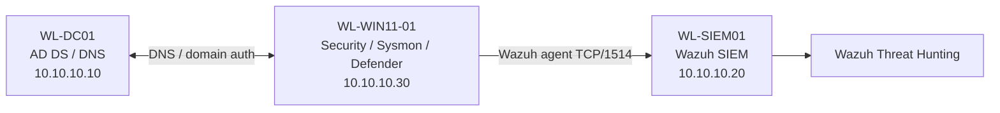

# LAB-04 — Lab Architecture

## Objective

Build a small isolated Windows-domain security environment and validate centralized security telemetry from a Windows endpoint to an Ubuntu-based Wazuh SIEM.

## Implemented systems

| Node | Operating system / function | Lab IP | Confirmed role |
| --- | --- | --- | --- |
| `WL-DC01` | Windows Server 2025; AD DS + DNS | `10.10.10.10` | Domain controller for `corp.whitleylab.test` |
| `WL-WIN11-01` | Windows 11 Pro | `10.10.10.30` | Domain-joined Wazuh-monitored endpoint (Agent `001`) |
| `WL-SIEM01` | Ubuntu Server; Wazuh | `10.10.10.20` | Wazuh manager, dashboard, event collection and alerting |
| `LAB-ISOLATED` | Hyper-V internal virtual switch | `10.10.10.0/24` | Isolated virtual lab network |

The Windows 11 endpoint was configured to use the domain-controller DNS server (`10.10.10.10`). An LDAP domain-controller SRV lookup resolved `wl-dc01.corp.whitleylab.test` to `10.10.10.10`, and the endpoint was confirmed joined to `corp.whitleylab.test`.

## Topology

## Connectivity and enrollment checks completed

- `Resolve-DnsName` returned the domain-controller `_ldap._tcp.dc._msdcs` SRV entry.
- `Test-NetConnection 10.10.10.20 -Port 1514` and `-Port 1515` succeeded from the Windows endpoint during enrollment.
- The endpoint's Wazuh service was running and Wazuh showed agent `001` as **active**.
- Windows logon was tested with a lab domain user; later SOC exercises ran under the local `labadmin` account.

## Scope note

Only the Windows 11 endpoint is evidenced as having a Wazuh agent in this lab. Do not assume equivalent coverage on the domain controller. The lab uses RFC 1918 private addresses, fictional domain identities, and authorized test activity.

[Return to project README](../README.md)
