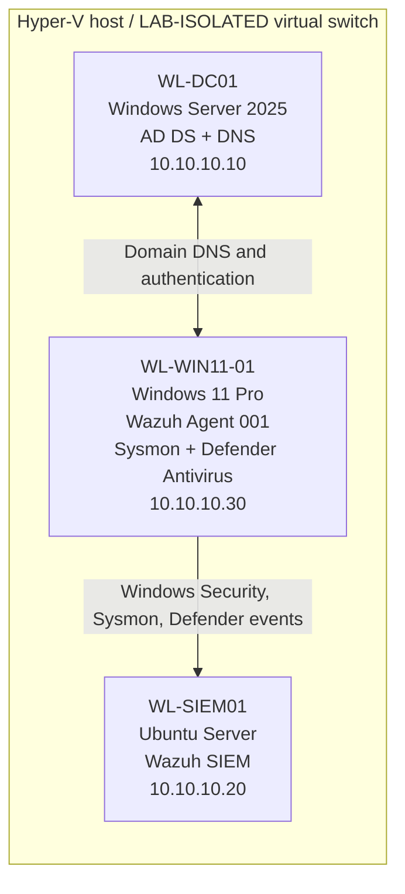

# LAB-04 — SOC Investigations & Detection Engineering

**Windows Security Monitoring | Wazuh SIEM | Sysmon | Microsoft Defender Antivirus | Active Directory**

## Project overview

LAB-04 is a hands-on security operations lab built to practice endpoint telemetry collection, SIEM alert triage, evidence correlation, and detection engineering. It combines an isolated Hyper-V network, an Active Directory domain, a Windows 11 endpoint, and a self-hosted Wazuh SIEM.

Each exercise compares centrally collected Wazuh alerts with original Windows events. Investigation writeups distinguish **observed evidence**, **analyst interpretation**, and **limitations**.

**Outcome:** Four controlled SOC investigation scenarios completed, including a live-tested custom Wazuh detection rule and a Microsoft Defender Antivirus quarantine test using harmless EICAR test data.

> **Scope:** This is a personal training environment. It does not demonstrate a real attacker, production incident response, Microsoft Defender for Endpoint licensing, or comprehensive threat coverage. All identities and addresses are lab-only.

## Architecture



| Component | Function | Address / identity |
| --- | --- | --- |
| `WL-DC01` | Active Directory Domain Services and DNS | `10.10.10.10`; `corp.whitleylab.test` |
| `WL-WIN11-01` | Domain-joined Windows 11 Pro endpoint | `10.10.10.30`; Wazuh agent `001` |
| `WL-SIEM01` | Ubuntu-based Wazuh manager, indexer, dashboard | `10.10.10.20` |
| `LAB-ISOLATED` | Hyper-V isolated virtual switch | `10.10.10.0/24` lab subnet |

**Telemetry flow:** Windows Security, Sysmon Operational, and Microsoft Defender Operational event logs → Wazuh Windows agent → Wazuh server and detection rules → Threat Hunting dashboard.

The Wazuh agent was confirmed **Active**. Its logs confirmed collection initialization for all three event channels. Specific Windows, Sysmon, and Defender alerts were verified at both the SIEM and source endpoint.

## Investigation results

| ID | Scenario | Source and SIEM evidence | Finding / disposition |
| --- | --- | --- | --- |
| **SOC-001** | Remote interactive logon | Wazuh `92653`; Security `4624`, event record `23313`, logon type `10` | Known local administrative logon; consistent with user-confirmed Hyper-V Enhanced Session activity. Source address `0.0.0.0` did not independently establish origin. |
| **SOC-002** | Failed authentication | Security `4625`, event record `23498`; status `0xC000006D`, substatus `0xC000006A` | Controlled bad-password attempt against local `labadmin`, independently correlated with Wazuh. |
| **SOC-003** | Custom process detection | Sysmon `1`, record `1536`; Wazuh custom rule `100201`, level `3` | Authorized PowerShell-to-Notepad execution detected by custom rule; original Sysmon event matched. |
| **SOC-004** | Antivirus response | Defender `1116`/record `376` → Wazuh `62123`; Defender `1117`/record `378` → Wazuh `62124` | Harmless EICAR test detected by real-time protection; Defender reported successful quarantine with error code `0x00000000`. |

### Additional high-severity alert triage

A Wazuh **level 12** alert (`92058`) identified execution of `C:\Windows\System32\sdbinst.exe`. Investigation matched Wazuh to **Sysmon Event ID 1, record 567**. The process was launched by `svchost.exe` associated with `PcaSvc` (Program Compatibility Assistant), and the executable had a **valid Microsoft digital signature**. An independently calculated SHA-256 matched the Sysmon-recorded hash. **Assessment: likely benign Windows compatibility activity**, not proven malicious. A valid signature and matching hash alone do not prove intent; surrounding activity was not exhaustively investigated.

## Detection engineering

The built-in Wazuh Sysmon process-creation rule `61603` is configured at **level 0**. To validate custom alerting, a low-severity rule was added under `/var/ossec/etc/rules/`:

- **Custom rule:** `100201`, inheriting parent rule `61603`
- **Condition:** process image ends with `\notepad.exe` (case insensitive)
- **Purpose:** generate a predictable lab alert for benign process creation, *not* label Notepad as malicious
- **Validation:** `wazuh-analysisd -t` returned `0`; manager confirmed active; live Notepad execution generated Wazuh Rule `100201`
- **Evidence:** Sysmon Event ID `1`, record `1536`, matched the Wazuh alert by event number, time, executable, account and parent process (`powershell.exe`)

The corresponding XML configuration should be published in `04-Detection-Engineering/` with a brief explanation of tuning and false-positive implications. A process name alone would not be a high-fidelity production detection.

## Skills demonstrated

- Windows endpoint onboarding and SIEM agent troubleshooting
- Collection of Windows Security, Sysmon, and Defender Antivirus event channels
- Windows-to-SIEM evidence correlation using event IDs, **EventRecordID**, timestamps, accounts, and process metadata
- Authentication failure-code interpretation and distinguishing expected logons from suspicious events
- Sysmon process lineage, digital-signature inspection, and on-disk hash verification
- Custom rule authoring, configuration validation, and live detection testing
- Defender Antivirus real-time detection and automated quarantine validation
- Triage documentation with clear findings, dispositions and uncertainties

## Repository layout

```text
LAB-04-Portfolio/
├── README.md
├── 01-Lab-Architecture/
├── 02-SIEM-Configuration/
├── 03-SOC-Investigations/
│   ├── SOC-001-Remote-Logon/
│   ├── SOC-002-Failed-Authentication/
│   ├── SOC-003-Process-Detection/
│   └── SOC-004-Defender-Response/
├── 04-Detection-Engineering/
├── 05-Evidence/
│   ├── SOC-001/
│   ├── SOC-002/
│   ├── SOC-003/
│   └── SOC-004/
└── 06-Interview-Preparation/
```

## Evidence standards and limitations

Every published investigation should include: objective, detection details, original event reference, relevant screenshots or sanitized exports, analysis, timeline, disposition, and limitations. Screenshots and exports must be inspected before publication for passwords, enrollment keys, tokens, or personal information. There is no claim of formal chain-of-custody controls or production-grade incident response.

A Wazuh rule's severity represents a rule classification, not automatic proof of malicious activity. The Microsoft Defender Antivirus integration used here is **not** a Microsoft Defender for Endpoint EDR deployment. The EICAR file is a safe, authorized antivirus-test pattern—not actual malware.

## Interview walkthrough

1. **Architecture:** Explain the domain controller, monitored endpoint, isolated Hyper-V network and Ubuntu-based Wazuh SIEM.
2. **Triage:** Open a Wazuh alert and trace it to the original Windows event via `EventRecordID`.
3. **Analysis:** Explain why the high-severity `sdbinst.exe` detection was assessed as likely benign, while acknowledging remaining limitations.
4. **Detection engineering:** Show custom Rule `100201`, explain the parent rule and process-image match, and display the validated Notepad alert.
5. **Response:** Walk through Defender Event `1116` (detection) and `1117` (quarantine), then explain why EICAR is a controlled test.

## Future improvements

- Add structured evidence exports and annotated investigation timelines
- Add a Wazuh agent on the domain controller for more complete authentication visibility
- Test additional controlled scenarios, including detection tuning and false-positive reduction
- Evaluate broader Sysmon coverage without overwhelming the SIEM with low-value events

---

*Initial README assembled from observed LAB-04 results. Investigation reports, sanitized evidence screenshots, and the custom rule source still need to be added before public GitHub publication.*
