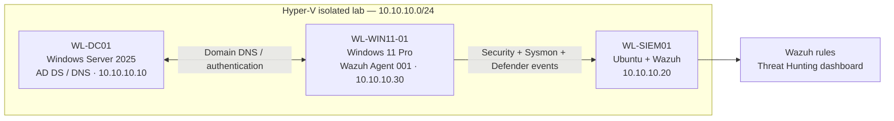

# LAB-04 — SOC Investigations & Detection Engineering

**Windows Security Monitoring · Wazuh SIEM · Sysmon · Microsoft Defender Antivirus · Active Directory**

> **Portfolio project / controlled lab.** Four documented SOC exercises with original Windows-to-Wazuh event correlation, a live-tested custom detection, and antivirus quarantine verification. This is not a record of real compromise or production incident response.

## At a glance

| Component | Verified implementation |
| --- | --- |
| Infrastructure | Three Hyper-V VMs on the isolated `10.10.10.0/24` lab network |
| Domain controller | `WL-DC01` — Windows Server 2025 AD DS/DNS (`10.10.10.10`) |
| Monitored endpoint | `WL-WIN11-01` — Windows 11 Pro (`10.10.10.30`), Wazuh agent **001** |
| SIEM | `WL-SIEM01` — Ubuntu Server / Wazuh (`10.10.10.20`) |
| Telemetry | Windows Security, Sysmon Operational, Microsoft Defender Antivirus Operational |
| Validated exercises | **4** SOC case reports plus additional `sdbinst.exe` process triage |
| Detection engineering | Original custom Wazuh rule **100201**, live-tested against Notepad process creation |
| Supporting artifacts | **25** categorized screenshots; original source XML; four written case reports |

## Architecture and data flow

The Wazuh Windows agent was confirmed active. Agent logs showed collection initialization for all three event channels, and the relevant events were subsequently observed in Wazuh Threat Hunting and independently verified in the endpoint logs.

[**Architecture and verification**](01-Lab-Architecture/README.md) · [**SIEM collection configuration**](02-SIEM-Configuration/README.md)

## Investigations

| Case | Scenario and disposition | Verified source + Wazuh evidence | Report |
| --- | --- | --- | --- |
| **SOC-001** | Remote-interactive logon; **authorized Hyper-V administrative activity** | Windows Security `4624`, record `23313`, type `10`; Wazuh `92653` | [Read SOC-001](03-SOC-Investigations/SOC-001-Remote-Logon/investigation-report.md) |
| **SOC-002** | Failed interactive logon; **controlled incorrect-password exercise** | Security `4625`, record `23498`; status `0xC000006D`, substatus `0xC000006A` | [Read SOC-002](03-SOC-Investigations/SOC-002-Failed-Authentication/investigation-report.md) |
| **SOC-003** | Sysmon process telemetry and **live custom-rule validation** | Sysmon Event `1`, record `1536`; custom Wazuh `100201`, level `3` | [Read SOC-003](03-SOC-Investigations/SOC-003-Process-Detection/investigation-report.md) |
| **SOC-004** | Harmless EICAR antivirus test; **successful quarantine reported** | Defender `1116`/record `376` → Wazuh `62123`; `1117`/record `378` → Wazuh `62124` | [Read SOC-004](03-SOC-Investigations/SOC-004-Defender-Response/investigation-report.md) |

### Additional high-severity process investigation

Wazuh Rule `92058` (level 12) flagged `C:\Windows\System32\sdbinst.exe`. The original Sysmon Event `1`, Record `567` was correlated with the SIEM alert. Process lineage pointed to `svchost.exe` associated with `PcaSvc`; Authenticode showed a valid Microsoft signature, and the on-disk SHA-256 matched the Sysmon record. **Assessment: likely benign Windows compatibility activity**, with the explicit limitation that a legitimate signature and matching file hash do not prove intent. See the [SOC-003 report](03-SOC-Investigations/SOC-003-Process-Detection/investigation-report.md).

## Detection engineering: Rule 100201

- **Objective:** verify that a benign process-creation event traverses Sysmon → Wazuh agent → Wazuh detection rules → SIEM alert.
- **Parent:** Wazuh built-in Sysmon Event 1 rule `61603` (level 0).
- **Custom child rule:** `100201`, level 3, matches the process image ending in `\notepad.exe` (case-insensitive PCRE2).
- **Validation:** `wazuh-analysisd -t` exited successfully; after `Start-Process notepad.exe`, Wazuh produced Rule `100201` and its source Sysmon Record `1536` was confirmed locally.
- **Limitation:** this is a deliberately broad **test rule**, not a production-grade malicious-process detector.

[**View the actual exported rule XML**](04-Detection-Engineering/lab04_notepad_rules.xml) · [**Detection engineering notes**](04-Detection-Engineering/README.md) · [**Screenshot evidence**](05-Evidence/README.md)

## Skills demonstrated

- SIEM deployment, endpoint agent onboarding, network/DNS troubleshooting and log channel collection
- Alert triage, Windows Security 4624/4625 interpretation, source-event correlation and evidence documentation
- Sysmon process lineage, Authenticode verification and SHA-256 comparison
- Custom Wazuh detection authoring, syntax validation and live execution testing
- Microsoft Defender Antivirus alerting, automated quarantine confirmation and Wazuh correlation
- Distinguishing authorized activity, benign tests and likely-benign alerts from proven compromise

## Repository contents

| Path | Purpose |
| --- | --- |
| [`01-Lab-Architecture/`](01-Lab-Architecture/README.md) | Lab topology and verified environment details |
| [`02-SIEM-Configuration/`](02-SIEM-Configuration/README.md) | Telemetry flow and sanitized Windows agent configuration |
| [`03-SOC-Investigations/`](03-SOC-Investigations/SOC-001-Remote-Logon/investigation-report.md) | Four case reports with methodology, findings and limitations |
| [`04-Detection-Engineering/`](04-Detection-Engineering/README.md) | Original Wazuh XML rule and validation notes |
| [`05-Evidence/`](05-Evidence/README.md) | 25 original lab screenshots organized by investigation |

## Scope, limitations and evidence handling

This is an isolated personal lab. No live adversary or real malware was involved. EICAR is an antivirus test pattern; Microsoft Defender **Antivirus** is not the same as a Microsoft Defender **for Endpoint EDR** deployment. A Wazuh alert level is a rule classification, not proof of compromise. No formal forensic chain of custody, immutable evidence storage, or comprehensive enterprise coverage is claimed. Only the Windows 11 agent was confirmed enrolled in Wazuh for these investigations; domain-controller Wazuh telemetry is outside this demonstrated scope.

Screenshots were visually reviewed before publication. Lab-only hosts, local accounts and private IPs are visible to make the correlation reproducible; no secrets were intentionally included. See the [evidence index](05-Evidence/README.md) and each case's limitations.

## Suggested interview walkthrough

1. Explain the Hyper-V three-VM network and the agent-to-SIEM telemetry path.
2. Pick SOC-002 to show the `4625` failure code and source record correlation.
3. Show the actual Rule `100201` XML, its matching alert, and Sysmon record `1536`.
4. Explain why the level-12 `sdbinst.exe` alert was assessed as likely benign *with limitations*.
5. Finish with Defender Events `1116`/`1117`, quarantine, and matching Wazuh Rules `62123`/`62124`.

*LAB-04 — October 2026. Educational SOC and detection-engineering portfolio.*
